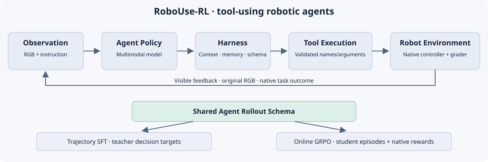

# RoboUse-RL

**A Modular Framework for Training Tool-Using Robotic Agents**

RoboUse-RL studies robot learning through an Agent policy that selects tools, supplies arguments, interprets feedback and recovers from failed interactions. Trajectory SFT and online Agentic RL share the same causal multimodal rollout contract and native robot tools.

This is the **v0.1.0 research release**. The full-parameter SFT implementation and CPU contracts are available. A800 training, real RoboDojo evaluation and online RL acceptance are **NOT_RUN** for this release; Online GRPO is **Experimental**. No benchmark or SOTA result is claimed.



## Learning through tools

| Conventional VLA | RoboUse-RL |
|---|---|
| Observation → VLM/VLA → predicted robot action | Observation + context + tools → Agent policy → tool calls → native controller → feedback |
| Learns an action representation/head | Learns decisions, tool selection, arguments and recovery |
| Model output is decoded into control signals | Harness validates/dispatches; native controller owns control signals |

**Policy**, **Harness**, **Tool**, **Controller**, **Environment** and **Trainer** have separate responsibilities. A tool-call receipt does not assert physical execution or task success. Native grading remains authoritative. See [architecture and extension interfaces](docs/architecture.md).

## Installation

Use Python 3.11 and a new environment:

```bash
git clone https://github.com/SanMumumu/RoboUse-RL.git
cd RoboUse-RL
# Until the release PR is merged: git switch release/v0.1.0
python -m venv .venv
source .venv/bin/activate
python -m pip install -e .
robouse --help
```

Install `.[train]` for HF Trainer/Accelerate/DeepSpeed training after selecting the appropriate PyTorch build. `requirements-train.lock` pins the resolved CUDA stack; `requirements-rtx-transport.lock` covers the separate RTX transport. Full A800 environment installation is not yet validated. Isaac/RoboDojo assets and environments are external, not pip dependencies of the base package.

An optional setup preview is available with `bash scripts/setup.sh --dry-run`; installation requires `--execute`. [Installation and reproducibility details](docs/reproducibility.md).

## Public fixture and dataset preparation

Run the public synthetic RGB/history fixture without private data, credentials or model downloads:

```bash
python examples/trajectory_sft/read_fixture.py --output outputs/fixture-prepared
```

The fixture is explicitly synthetic and unscored. It exercises the same trajectory/window reader, including a valid early decision followed by incomplete history. It is not robot training evidence.

Real preparation uses original RGB and verifiable causal history, with assistant-only targets. Full trajectories and qualified local windows are tracked separately. **Seed0=train, Seed1=validation, Seed2=sealed final test.** Cross-role identities and known physical aliases are rejected; old mixed training caches are not reused.

```bash
bash scripts/prepare_data.sh --config /path/to/data.json \
  --data-root /path/to/raw --output /path/to/raw/prepared-v1 --execute
```

The configuration supports multiple sources, explicit weights, deterministic coverage or weighted sampling and frozen split manifests. SFT registers test paths without opening test targets. Missing Seed2 remains `PENDING_TEST`. See [data schema, mixtures and migration commands](docs/data_format.md). Datasets, original images/videos and weights are transferred separately from Git.

## Trajectory SFT

The actual implementation uses HF Trainer, Accelerate and DeepSpeed ZeRO-3, with language/vision/connector parameters trainable. It supports original HF IDs or verified local directories, model-specific processors, assistant/tool-call masks, global target-token normalization, eight distinct shards, length bucketing, accumulation and full optimizer/RNG checkpoint resume. Other GPU world sizes and PEFT modes are not validated in this release.

On an **allocated A800 node**:

```bash
# Preview first; explicit --execute is required for GPU work.
bash scripts/train_sft.sh --config configs/sft/qwen35_2b.yaml \
  --train-data /path/to/prepared/seed0-train.jsonl \
  --val-data /path/to/prepared/seed1-val.jsonl \
  --data-root /path/to/data --output-dir outputs/sft_exp01 --num-gpus 8 --dry-run

# Independent four-step model-specific save/reload/resume acceptance.
bash scripts/train_sft.sh --config configs/sft/qwen35_2b.yaml \
  --train-data /path/to/prepared/seed0-train.jsonl \
  --val-data /path/to/prepared/seed1-val.jsonl \
  --data-root /path/to/data --output-dir outputs/smoke2b --num-gpus 8 --smoke --execute

# Formal training after matching acceptance succeeds.
bash scripts/train_sft.sh --config configs/sft/qwen35_2b.yaml \
  --train-data /path/to/prepared/seed0-train.jsonl \
  --val-data /path/to/prepared/seed1-val.jsonl \
  --test-data /path/to/prepared/seed2-test.jsonl \
  --data-root /path/to/data --output-dir outputs/sft_exp01 --num-gpus 8 \
  --smoke-acceptance outputs/smoke2b/smoke-acceptance.json --execute
```

Use `configs/sft/qwen35_4b.yaml` for the main 4B model; it requires its own processor profile and GPU acceptance. Resume with the identical command plus `--resume outputs/sft_exp01/checkpoint-N`. Steps are calculated from the frozen dataset plan, rather than a historical hard-coded step count. Seed1 NLL selects checkpoints; test targets are never read. [Training, local-model inventory and resume](docs/training.md).

## Online Agentic RL — Experimental

GRPO optimizes multi-turn **tool-using trajectories**, not low-level continuous actions. Collection freezes the current student policy; each group contains independent episodes from a comparable native initial state. Actual input RGB/tensors, generated IDs, behavior LP, masks, native reward and policy version are preserved. Group-relative advantages, clipping, fixed SFT-reference KL and episode-length weighting have CPU numerical references.

```bash
bash scripts/train_rl.sh --config configs/rl/grpo_qwen35_2b.yaml \
  --init-checkpoint /path/to/sft_checkpoint --output-dir outputs/rl_exp01 \
  --num-gpus 8 --dry-run
```

Execution requires `--allow-experimental --execute`, explicit RTX environment endpoints and a bounded budget. The real sampler-to-oracle probability check must pass the retained **0.02** assertion; behavior LP is never overwritten. No teacher episode or mock data is substituted. Unsupported execution fails before CUDA. Full A800/Isaac numerical and multi-round acceptance is **NOT_RUN**. [GRPO validation/resume command and limitations](docs/training.md#experimental-online-grpo).

## RoboDojo evaluation and videos

Run Isaac/native controls on an **RTX node** and student inference on **A800**, connected by authenticated loopback RPC over SSH. See [worker setup and machine-specific commands](docs/evaluation.md).

```bash
# A800: native Seed1 validation.
bash scripts/evaluate.sh --config configs/evaluation/robodojo.yaml \
  --checkpoint /path/to/checkpoint --split val \
  --identities /path/to/seed1-identities.jsonl --output-dir outputs/val_exp01 --execute

# A800: explicit final native test only.
bash scripts/evaluate.sh --config configs/evaluation/robodojo.yaml \
  --checkpoint /path/to/checkpoint --split test --final-test \
  --identities /path/to/seed2-identities.jsonl --output-dir outputs/eval_exp01 --execute

# A800 or local machine after downloading the run.
bash scripts/view_results.sh --output-dir outputs/eval_exp01 --execute
```

Outputs include `metrics.json`, `episodes.jsonl`, `run_manifest.json`, original `videos/`, tool timelines and native score evidence. Success rate excludes unscored attempts from its denominator and reports coverage separately. Decision/tool/episode latency, observable token usage, failure category and component versions are recorded; unavailable measurements remain null. Head/left-wrist/right-wrist views are preserved where supported, including failures. Extract `offline.zip` for self-contained HTML/MP4 viewing, or serve the result on `127.0.0.1` only. No old video is attributed to a new policy.

## Optional teacher collection

The isolated [Astra teacher integration](docs/teacher_collection.md) supports bounded collection, selected-account quota admission, resume, original RGB/transcript/video sealing and immutable data snapshots. Default effort is **high**, configurable with `--effort` or JSON; it is not hard-coded. It requires an external supported CLI and explicit authorization/resources. SFT has no dependency on that service. Actual teacher calls in this release are **NOT_RUN**.

## Feature maturity

| Feature | Implementation | Validation |
|---|---|---|
| Public trajectory schema, RGB fixture, qualified windows | Supported | CPU |
| Fixed roles, alias checks, data migration, multi-source mixtures | Supported | CPU / synthetic original-format artifacts |
| Tool registry, context, memory, native dispatch boundary | Supported | CPU contracts |
| Full-parameter Qwen3.5 SFT, eight-rank ZeRO-3, resume | Implemented | Real tiny HF CPU update/resume; A800 2B/4B NOT_RUN |
| Model-specific processor/masks | Implemented | Local 2B processor; 4B NOT_RUN |
| Grouped multi-turn online GRPO | Experimental | CPU numerical references; actual A800 LP/Isaac NOT_RUN |
| RoboDojo native grading, RPC and video viewer | Experimental integration | CPU contracts; new real native episodes NOT_RUN |
| Optional Astra teacher collector | Experimental integration | Fake RPC and synthetic seal/resume; real calls NOT_RUN |
| PEFT, additional policy/environment backends, ROS | Planned | Unsupported modes fail explicitly |

## Reproducibility and tests

```bash
python -m pip install torch==2.7.0 torchvision==0.22.0 --index-url https://download.pytorch.org/whl/cpu
python -m pip install -e '.[test,cpu-test]'
python -m pytest -q
OMP_NUM_THREADS=1 torchrun --standalone --nproc_per_node=8 \
  -m robouse.cpu_distributed --output outputs/cpu-ddp.json --execute
```

Run manifests bind configuration, Git SHA, random seed, dataset hashes and package versions. Checkpoint markers cover full state; resume contracts reject mismatches. The [validation record](agent/VALIDATION.md) distinguishes PASS, FAIL, BLOCKED and NOT_RUN. GitHub Actions is configured for CPU checks. [Reproducibility](docs/reproducibility.md) · [migration audit](agent/MIGRATION_AUDIT.md).

## Limitations

No A800 throughput/memory, real closed-loop student success or released benchmark score is claimed. Original research includes limited train-instance overfitting and known raw LP reconstruction failures; neither is a release benchmark. GRPO's new actual-kernel parity must pass on the target hardware. The no-KV-cache reference sampler prioritizes traceability over speed. Native integration requires compatible external simulator/assets and explicit allocations. Depth is representable in the schema but the released Qwen training adapter consumes RGB only. PEFT and other environments remain planned.

## Citation and acknowledgements

Use [CITATION.cff](CITATION.cff) to cite this software; no accompanying paper is claimed. The modular organization is informed by [starVLA](https://github.com/starVLA/starVLA). We retain selected Agent-as-Policy converters/codecs, the AGP tool/control snapshot and attributed [ms-swift](https://github.com/modelscope/ms-swift) 4.2.1 scheduler/protocol code. Guava, AgenticRoboRL and ResearchBoost-Agent informed the engineering audit; their entire repositories are not vendored. RoboDojo/XPolicyLab provide the external simulator and native scoring boundary.

Released under [Apache-2.0](LICENSE); see [NOTICE](NOTICE) and third-party provenance. Contributions should include explicit input/output contracts and honest validation scope; see [CONTRIBUTING.md](CONTRIBUTING.md).
